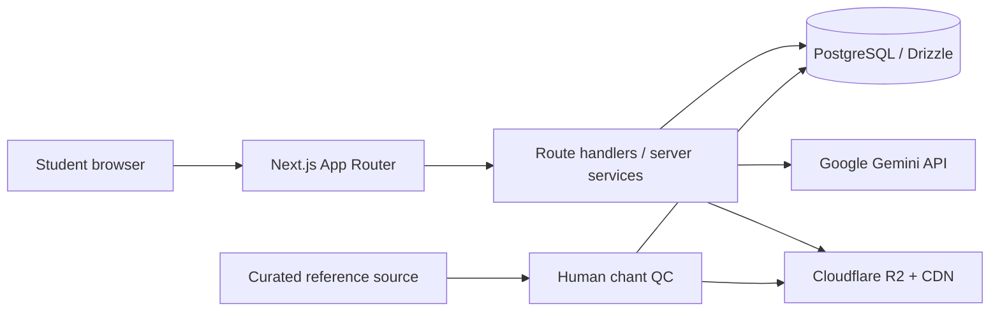
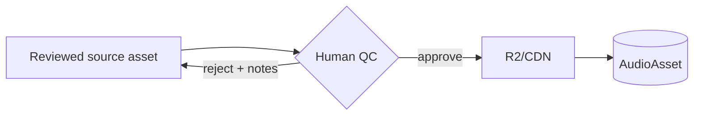

# Architecture — Samhita Pathan

## System Context

The deployed product is one Next.js application with server-only services and PostgreSQL. This matches Vercel deployment while avoiding an unnecessary second API service. Domain services isolate storage, Gemini and auth so a separate API can be extracted later.

## Boundaries
- `src/app`: pages, layouts and route handlers.
- `src/components`: client interactions and presentational UI.
- `src/db`: Drizzle schema/client and repositories.
- `src/lib/auth`: cookie session and authorization helpers.
- `src/services/gemini`: the only Gemini SDK boundary.
- `src/services/storage`: R2/S3 signed upload and asset helpers.
- Content import is a controlled operational workflow; it is not a runtime dependency.

## Authentication
Email/password registration hashes with bcrypt (cost 12). An encrypted/signed JWT session in an httpOnly `samhita_session` cookie contains user ID and expiration only. Cookie is sameSite=lax, secure in production and 7 days. Protected handlers load the database user and enforce object ownership. Auth responses remain generic. Add distributed rate limiting before public launch; memory-only limits are inadequate on serverless.

## Data Model
Core tables: `users`, `samhitas`, `chapters`, `shlokas`, `audio_assets`, `recitation_attempts`, `user_progress`, and `ai_content`. IDs are UUIDs. `audio_assets` carries reference/user type, meter, QC state, notes, origin and generation timestamp. Unique indexes prevent duplicate references and progress rows.

## Gemini Service
All calls use `GEMINI_API_KEY` from the server. Each capability has a versioned prompt, Zod output schema, 20–45 second timeout, at most one schema-repair retry, and typed safe errors. Cache reusable shloka outputs by `(shlokaId, capability, language, promptVersion)`. Recitation feedback is user-specific and not shared. Audio can be inline for small uploads; production should upload to Gemini Files or securely fetch from storage for larger files. Provider output is advisory and never rendered as HTML.

## Reference Audio Pipeline

Audio acquisition is an out-of-band content operation—not CI, Vercel, Railway CPU, or the normal deploy target. The QC lifecycle is `pending → approved | rejected`; only approved references are returned by the API. The app depends only on AudioAsset lookups, so the content workflow can evolve without breaking clients.

### R2/S3
Use private objects plus short-lived signed URLs for user recordings. Reference audio may use a public CDN URL after approval. Configure least-privilege credentials, immutable/cacheable versioned reference keys, CORS limited to the app origin, content-type allowlists and upload size limits.

## Progress State
A progress row is keyed by user/shloka with `currentStep`, completed step array, timestamps and quiz score. Updates are idempotent. Client optimism is allowed, but the server is authoritative.

## Resilience
- Missing approved reference: 200 with `audio: null`, not an exception.
- Gemini timeout/schema error: typed 503/422-compatible domain error; preserve cached content.
- Storage failure: attempt remains failed/retryable; never expose raw provider messages.
- Health endpoint checks database; deeper readiness can validate storage configuration without calling paid providers.

## Security
Threats include credential stuffing, CSRF, IDOR on recordings, upload abuse, malicious MIME/content, AI prompt injection from content, signed URL leakage and excessive AI cost. Mitigations: sameSite cookie, origin checks on mutations, object ownership, Zod validation, MIME/size limits, randomized keys, short signed URLs, quotas, redacted logging, server-only secrets and spend alerts.

## Deployment
- App: Vercel Node runtime. Do not use GitHub Pages; static hosting cannot support auth, routes, database, uploads or Gemini secrets.
- DB: managed PostgreSQL with pooled serverless connection URL and migration job.
- Audio: Cloudflare R2/CDN.
- CI: install lockfile, lint, typegen, TypeScript, unit/integration, build, Playwright against ephemeral DB.
- Rollback: deploy rollback plus backward-compatible database migrations; never destructively drop in the same release as code removal.

## Observability
Structured request logs with request ID, route, latency and safe error code; never audio, Sanskrit prompts containing user data, tokens or passwords. Track auth failures, Gemini latency/error/schema retries, playback availability, upload failures, and R2 egress. Add Sentry/OpenTelemetry before beta.
